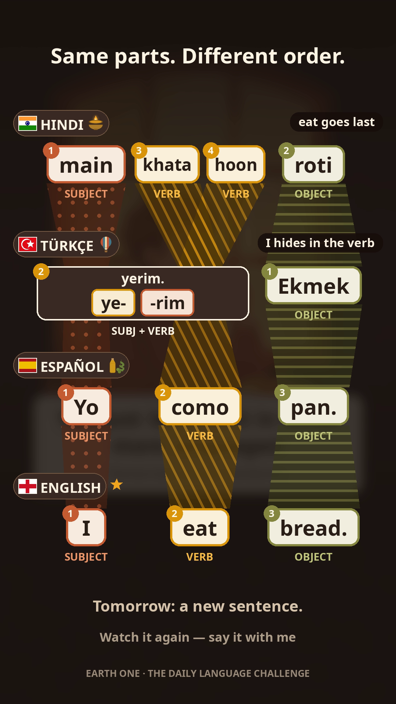

# DLC-001 · "I eat bread." — Publication Batch 1

**Earth One — The Daily Language Challenge.** One everyday sentence, learned in many languages at the same time. This folder is the open production context ("branch") behind the batch: the exact HTML file systems the six published videos were rendered from.

*The batch's signature layer: the ending diagram. Each language is a row; three ribbons — SUBJECT (terracotta), VERB (amber), OBJECT (olive) — pour through the rows in spoken order (circled numbers). Turkish fuses its subject into the verb (one block that splits inside: **ye-** + **-rim**); Hindi splits its verb across the end of the sentence (**khaati + hoon**). Same parts. Different order.*

## The six versions

One sentence, six doors into it — published together as one batch:

| Version | Opening (the door) | Teaches | Directed by |
|---|---|---|---|
| EN opening | English | Spanish · Hindi · Turkish | Archer |
| ES opening | Spanish | English · Hindi · Turkish | Archer |
| HI opening | Hindi | English · Spanish · Turkish | Archer |
| TR opening | Turkish | English · Spanish · Hindi | Archer |
| Mina EN | English | Spanish · Hindi · Turkish | Mina Nayebi |
| Mina TR | Turkish | English · Spanish · Hindi | Mina Nayebi |

Every video runs the same teaching rhythm: **listen** (slow, per language) → **say it with me** (word-by-word teleprompter) → **your turn** (a real pause) → a closing claim → a repeat pass that builds the ribbons diagram.

## The files

- `index.html` — the main branch (v4): Tab 0 context, transcript, word timings, visuals, the players, and the full decision record for the B1 line.
- `mina-branch.html` — Mina's branch: her palette, her character direction, her closing line, and the converged ending standard.
- `diagram-ribbons.png` — the completed ending diagram (EN opening version).

Production method: **context production** — the video is a derivative of this file system, never the other way round. The batch was re-cut once to its final form: no early diagram flashes; the diagram lives only at the end, where all the sentences are spoken together.

*An experimental project by Hadosh Academy / Earth One — iterated in public.*
