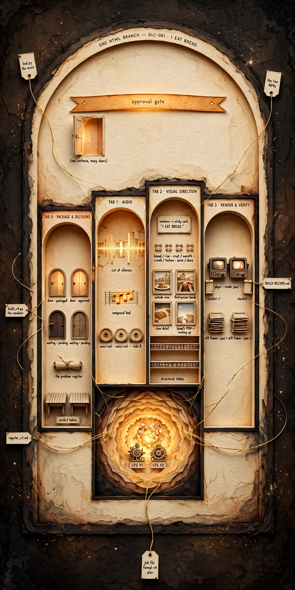

# DLC-001 — "I eat bread."

**Earth One · The Daily Language Challenge**

One sentence, learned in several languages at the same time —
associative learning, one short video at a time. This page is
the production home of the first sentence package: every
decision, the audio, the visuals, the render and its
verification live in one dashboard file.

**▶ Open the dashboard: [index.html](index.html)** — it plays
both built versions and carries their full evidence:

- **V1 — English opening** · teaches Turkish · Persian · German · French
- **V2 — Turkish opening** · teaches English · Persian · German · French

This dashboard is also the review interface for this package:
the same link travels into the videos' descriptions when they
publish, so anyone can see exactly how the videos were made.

_An experimental series by Hadosh Academy, iterating in
public on retention and learning._
